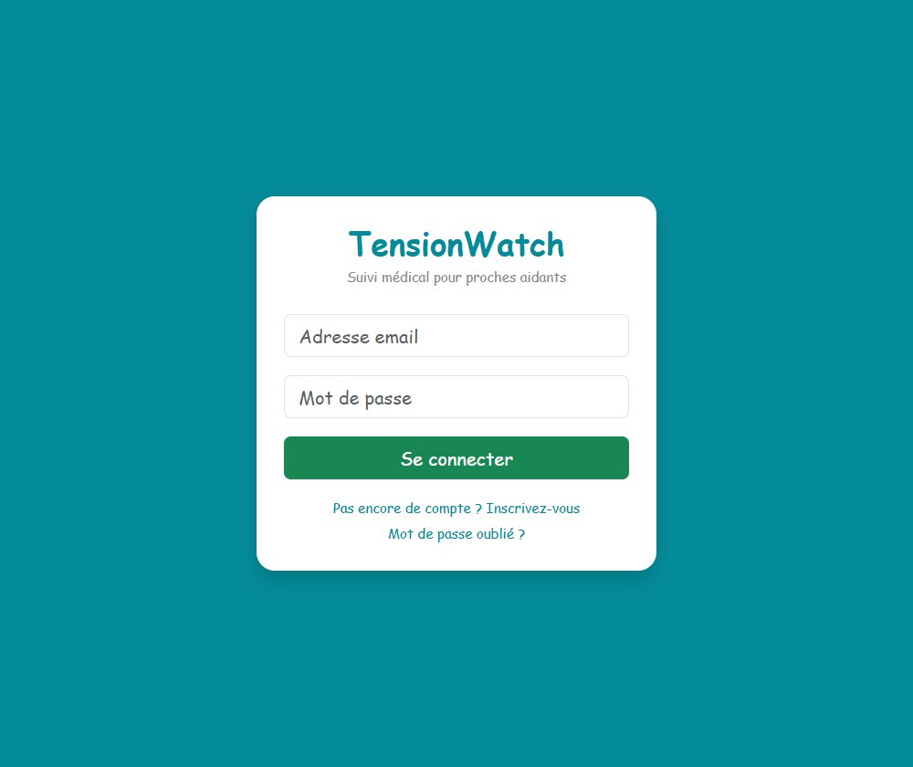

# TensionWatch — API Spring Boot + SPA React

Réécriture moderne de [TensionWatch](https://github.com/rayanerakpo-blip/TensionWatch) :
une API REST en Spring Boot et une interface React/TypeScript, pour séparer la logique
métier du rendu et passer à une authentification stateless par JWT.



---

## Architecture

```
TensionWatch-Java-React/
├─ backend/    # API REST — Spring Boot 3.2, Java 17, Spring Data JPA, Spring Security
└─ frontend/   # SPA — React 19, TypeScript, React Router 7, Axios, Bootstrap 5
```

### Backend

- 9 contrôleurs REST : authentification, patient, tension, médicaments, effets indésirables,
  rappels, conseils, contacts d'urgence, tableau de bord, compte.
- Sécurité JWT : `JwtUtils`, `AuthTokenFilter`, `UserDetailsServiceImpl`.
- Entités JPA, repositories Spring Data, DTO et validation.
- Service métier `TensionEvaluationService` : niveau de gravité selon les seuils OMS/HAS.
- Base MySQL, schéma fourni dans `tensionwatch.sql`.

### Frontend

- 12 pages : connexion, inscription, tableau de bord, patient, tension, médicaments, effets
  indésirables, rappels, conseils, urgences, compte, export.
- `AuthContext` et `PrivateRoute` pour protéger les routes.
- Graphiques Chart.js, composants React Bootstrap.
- Tests avec React Testing Library.

## Prérequis

- Java 17+
- Node.js 18+
- MySQL 8

## Lancer le backend

```bash
cd backend
./mvnw spring-boot:run
```

Variables d'environnement (facultatives en local) :

| Variable | Valeur par défaut |
|---|---|
| `DB_HOST` | `localhost` |
| `DB_PORT` | `3306` |
| `DB_NAME` | `TensionWatchCopie` |
| `DB_USER` | `rayane` |
| `DB_PASSWORD` | *(vide)* |
| `JWT_SECRET` | clé de développement |

L'API écoute sur `http://localhost:8080`.

## Lancer le frontend

```bash
cd frontend
npm install
npm start
```

L'application est disponible sur `http://localhost:3000`.

## Base de données

Importer `tensionwatch.sql`, puis adapter le nom de la base dans les variables
d'environnement du backend.

## Limites connues

- Pas encore de tests d'intégration backend.
- Pas de déploiement public : l'application se lance en local.
- La clé JWT par défaut est une clé de développement, à remplacer en production.

## Auteur

**Rayane AKPO** — [github.com/rayanerakpo-blip](https://github.com/rayanerakpo-blip)
